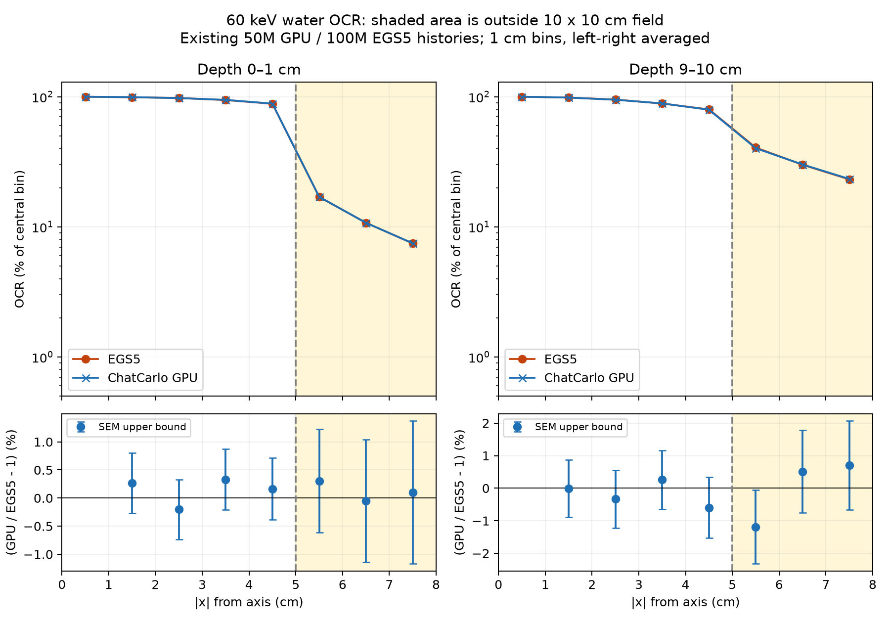

# 60 keV 水ファントムOCR：照射野外の追加解析

2026-10-26。公開ページの図Aに使った既存データを再集計した。輸送計算の追加実行・公開ページの変更は行っていない。

## 方法

- GPU: `runs/diag_water_60kev_gpu/dose.npz`。`run/job.json`で5.0×10⁷光子、seed 20261023、100バッチを確認。scene.yamlの既定光子数ではなく実行jobの値を用いた。
- EGS5: `docs/egs5_crosscheck/revalidation_2026_10_07/comparison.csv`のEGS5列のみ。1.0×10⁸光子。CSV内の旧NumPy計算値や旧相対差は使用していない。
- 60keV単色・10×10cm平行ビーム、水30×30×20cm。格子原点(-65,-65,-50)cm、幅1cmをNPZで確認。
- 公開図と同じ採点：y=-1〜1cmを平均、xの左右対称な区間を平均。深さ0〜1cm、9〜10cm。各コードの中心区間（|x|=0〜1cm）を100%に正規化。
- 幾何学的照射野端は|x|=5cm。照射野外は|x|=5〜6、6〜7、7〜8cmの各1cm区間。中心座標では5.5、6.5、7.5cm。50%位置からの距離による領域分けではない。
- 局所差 = (GPUの正規化OCR / EGS5の正規化OCR − 1)×100%。平均は局所差の絶対値の算術平均。空間積分・線量加重平均ではない。
- 既存の照射野内6点の平均絶対差0.23%、最大0.3%を再現し、既存図と同じデータ処理であることを確認。

## 結果

|深さ|照射野外の点数|平均絶対差|最大絶対差|
|---|---:|---:|---:|
|0–1 cm|3|0.152%|0.305%|
|9–10 cm|3|0.800%|1.188%|
|両深さ合計|6|0.476%|1.188%|

|深さ|中心からの距離 | EGS5 OCR (%) | GPU OCR (%) |局所差 (%) |中心100%に対する差（ポイント）|
|---|---|---:|---:|---:|---:|
|0–1 cm|5〜6 cm|16.965|17.017|+0.305|+0.052|
|0–1 cm|6〜7 cm|10.744|10.739|-0.050|-0.005|
|0–1 cm|7〜8 cm|7.464|7.472|+0.101|+0.008|
|9–10 cm|5〜6 cm|40.650|40.167|-1.188|-0.483|
|9–10 cm|6〜7 cm|29.999|30.153|+0.514|+0.154|
|9–10 cm|7〜8 cm|23.168|23.329|+0.698|+0.162|

最大差は深さ9〜10cm、|x|=5〜6cm。EGS5のOCR40.650%に対しGPUは40.167%で、局所差−1.188%、中心100%に対する差は−0.483ポイント。

参考として、正規化せずGy/historyを直接比べた照射野外6点の平均絶対差は0.488%、最大1.088%。中心の正規化によって大きな差が隠れた結果ではない。原値はbins.csvに保存。

## 統計と解釈の限界

見た目で重なっているという観察に対応し、調べた照射野外6点の局所差は約1.2%以内だった。ただし、新たな合否判定や「1%精度の保証」ではない。

- 照射野外の各点の正規化前相対SEMの上界はGPUで0.28〜0.49%、EGS5で0.58〜0.88%。GPUの該当ボクセルはすべて100バッチが寄与。
- 保存データにボクセル間・左右間・正規化基準との共分散がない。SEMを単純に独立として縮めない。平均のSEMは個別SEMの平均を上界とし、分子と中心値の比についても共分散未知の上界を使用。独立な両コードの項だけ二乗和で合成した。
- 正規化後の局所差の1 SEMの上界は約0.92〜1.37パーセントポイント。図の誤差棒は推定SEMそのものではなく、この保守的上界。これを使って統計的一致や合格を宣言しない。
- 保存されたEGS5の側方データは|x|=8cmまで。それより遠い照射野外は比較できていない。左右平均した1cm区間の結果なので、左右個別・微細なペナンブラの一致を示すものではない。
- EGS5の既存参照にはRayleigh角度分布fitの警告による未定量の不確かさがある。旧NumPy再検証の従来基準1不合格・4統計不足は今回のGPU再集計と別の比較であり、今回の結果で取り消さない。

## 再現と成果物

`.venv/bin/python docs/jsmp133/ocr60_out_of_field/analyze.py`

- `analyze.py`: 既存データの抽出・集計と図の生成
- `bins.csv`: 全区間のOCR、局所差、原値の差、SEM上界
- `summary.json`: 集計値・入力SHA256・実行job・解析条件
- `ocr_outside.png`: 上段OCR（対数軸）、下段局所差。黄色が照射野外

