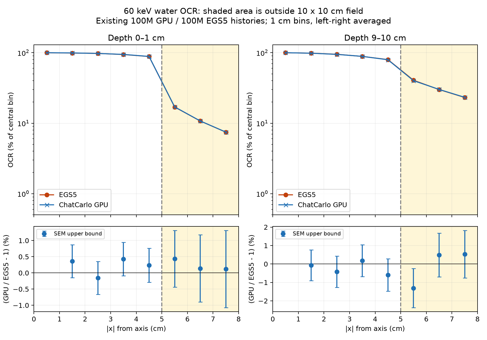

# 60keV OCR照射野外：1億光子版

2026-10-26。旧5,000万光子版と同じ計算法・範囲。入力のみ統合1億光子へ更新。詳細条件は隣の `../ocr60_out_of_field/RESULTS.md` と、今回の `summary.json` を参照。旧結果は上書きしていない。

|深さ|平均絶対差|最大絶対差|
|---|---:|---:|
|0–1 cm|0.231%|0.435%|
|9–10 cm|0.776%|1.311%|
|all|0.504%|1.311%|

平均は各点のEGS5値に対する局所差の絶対値。深さ2区間×照射野外3区間の6点。1cm幅・左右平均。保存データの範囲は|x|=8cmまで。誤差棒は共分散未知として求めたSEM上界で、正式な合否判定ではない。EGS5のRayleigh fit警告による未定量の不確かさも引き継ぐ。公開ページのOCR評価範囲は照射野内のまま。

