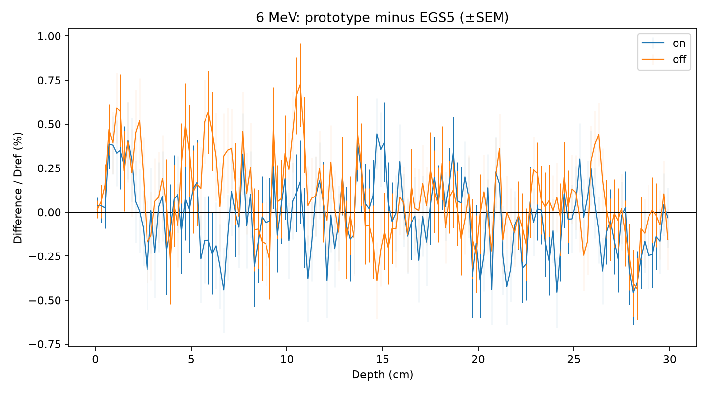
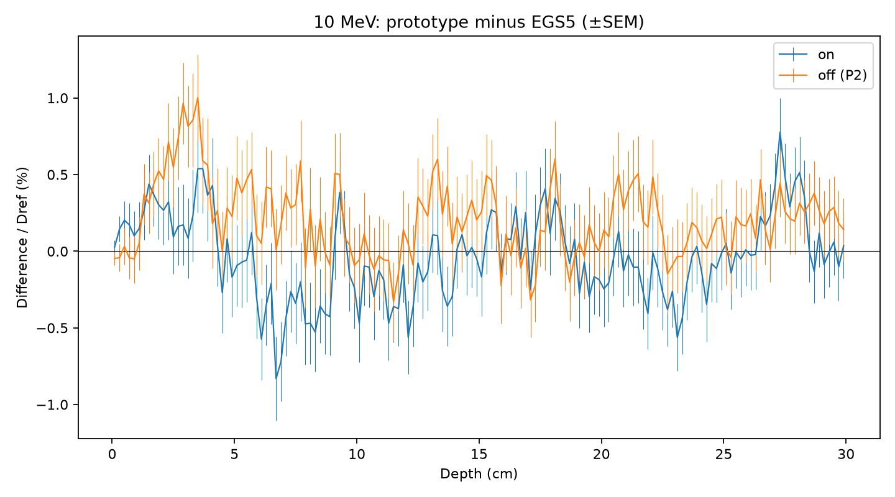

# P2c — 飛行中の陽電子消滅

## 予想

飛行中消滅の割合は6/10 MeVで約6.3/8.5%。線量変化の予想と結果は下表に並べる。

## 結果

差とSEMの単位は%（深部・ビルドアップ・ピーク付近はDref比、対応表の線量は引かれる側の領域平均比）。

### on6_minus_EGS5

固定した深部のブロック平均の差が1%以内

| bin | 差 ± SEM (% Dref) | 状態 | |差|+1.96 SEM |

|---|---:|---|---:|

| 29–53 | -0.047056 ± 0.104914 | 1%以内 | 0.252688 |

| 54–78 | +0.033637 ± 0.094356 | 1%以内 | 0.218575 |

| 79–103 | -0.015535 ± 0.090370 | 1%以内 | 0.192661 |

| 104–128 | -0.082540 ± 0.088103 | 1%以内 | 0.255221 |

| 129–149 | -0.148908 ± 0.086325 | 1%以内 | 0.318104 |

buildup (fine bin 6–43): +0.262081 ± 0.125854%（判定なし）。

near (coarse bin 11–28): -0.044665 ± 0.122680%（判定なし）。

### on10_minus_EGS5

固定した深部のブロック平均の差が1%以内

| bin | 差 ± SEM (% Dref) | 状態 | |差|+1.96 SEM |

|---|---:|---|---:|

| 38–62 | -0.248337 ± 0.134365 | 1%以内 | 0.511692 |

| 63–87 | +0.007334 ± 0.137449 | 1%以内 | 0.276734 |

| 88–112 | -0.062953 ± 0.134435 | 1%以内 | 0.326446 |

| 113–149 | +0.029442 ± 0.104599 | 1%以内 | 0.234456 |

buildup (fine bin 10–71): +0.244989 ± 0.152227%（判定なし）。

near (coarse bin 18–37): -0.155061 ± 0.160838%（判定なし）。

### off6_minus_EGS5

固定した深部のブロック平均の差が1%以内

| bin | 差 ± SEM (% Dref) | 状態 | |差|+1.96 SEM |

|---|---:|---|---:|

| 29–53 | +0.222931 ± 0.098599 | 1%以内 | 0.416185 |

| 54–78 | +0.010849 ± 0.085451 | 1%以内 | 0.178332 |

| 79–103 | +0.023372 ± 0.088210 | 1%以内 | 0.196264 |

| 104–128 | +0.028288 ± 0.085511 | 1%以内 | 0.195889 |

| 129–149 | -0.019638 ± 0.083134 | 1%以内 | 0.182582 |

buildup (fine bin 6–43): +0.370740 ± 0.132507%（判定なし）。

near (coarse bin 11–28): +0.141238 ± 0.121136%（判定なし）。

### 理論との対応

| 量 | 予想 | 結果 ± SEM (%) | EGS5値 ± SEM | EGS5との差 ± 合成SEM |

|---|---|---:|---:|---:|

| 6 MeV shallow on−off | 約−0.2% | -0.233126 ± 0.081581 | -0.202301 ± 0.076455 | -0.030825 ± 0.111807 |

| 6 MeV whole on−off | 約−0.06% | -0.142044 ± 0.039150 | -0.059344 ± 0.042219 | -0.082700 ± 0.057578 |

| 6 MeV shallow on−EGS5 | 0に近い | +0.012508 ± 0.078576 | — | — |

| 10 MeV shallow on−P2 off | 約−0.5% | -0.383479 ± 0.103952 | — | — |

| 10 MeV whole on−P2 off | 約−0.3%（消滅と放射損失の両方の変更からの参考値） | -0.302716 ± 0.059652 | — | — |

| 6 MeV flight/pairs | 約6.3% | +6.156461 ± 0.025346 | +6.258580 ± 0.026453 | -0.102120 ± 0.036636 |

| 10 MeV flight/pairs | 約8.5% | +8.310946 ± 0.026743 | +8.424503 ± 0.030588 | -0.113558 ± 0.040630 |

割合の試作SEMは100バッチの割合の標本標準偏差/√100。EGS5の割合SEMは集計回数からの二項標準誤差。

### 収支・回数・時間

| 計算 | 沈着/入射 | 対生成 | 静止 | 飛行中 | 陽電子脱出 | 違反 | 失敗 | 秒 |

|---|---:|---:|---:|---:|---:|---|---|---:|

| p2c_on_6 | 0.440216226 | 833742 | 767895 | 51329 | 14518 | [0, 0, 0] | [0, 0] | 4794.072 |

| p2c_off_6 | 0.440842416 | 834440 | 819696 | 0 | 14744 | [0, 0, 0] | [0, 0] | 4772.874 |

| p2c_on_10 | 0.384755597 | 822626 | 723803 | 68368 | 30455 | [0, 0, 0] | [0, 0] | 3422.211 |

## 考察

基準v2はブロックの点推定を±1%と比較する。真の差が95%の確度で±1%以内という意味ではない。

予想との比較は記述であり、5.1の判定には使わない。陽電子にも電子の阻止能・硬衝突・弾性散乱を使う近似は残る。

10 MeV全体の約−0.3%はEGS5で消滅と放射損失の両方を変えた値に由来し、消滅だけの定量的な予想ではない。

6 MeV shallow on−off: 予想 約−0.2%、結果 -0.233126 ± 0.081581%（SEM）。 EGS5測定値との差 -0.030825 ± 0.111807%。 この数値とSEMを併せて解釈し、機械的な一致判定は付けない。

6 MeV whole on−off: 予想 約−0.06%、結果 -0.142044 ± 0.039150%（SEM）。 EGS5測定値との差 -0.082700 ± 0.057578%。 この数値とSEMを併せて解釈し、機械的な一致判定は付けない。

6 MeV shallow on−EGS5: 予想 0に近い、結果 +0.012508 ± 0.078576%（SEM）。 この数値とSEMを併せて解釈し、機械的な一致判定は付けない。

10 MeV shallow on−P2 off: 予想 約−0.5%、結果 -0.383479 ± 0.103952%（SEM）。 この数値とSEMを併せて解釈し、機械的な一致判定は付けない。

10 MeV whole on−P2 off: 予想 約−0.3%（消滅と放射損失の両方の変更からの参考値）、結果 -0.302716 ± 0.059652%（SEM）。 この数値とSEMを併せて解釈し、機械的な一致判定は付けない。

6 MeV flight/pairs: 予想 約6.3%、結果 +6.156461 ± 0.025346%（SEM）。 EGS5測定値との差 -0.102120 ± 0.036636%。 この数値とSEMを併せて解釈し、機械的な一致判定は付けない。

10 MeV flight/pairs: 予想 約8.5%、結果 +8.310946 ± 0.026743%（SEM）。 EGS5測定値との差 -0.113558 ± 0.040630%。 この数値とSEMを併せて解釈し、機械的な一致判定は付けない。
