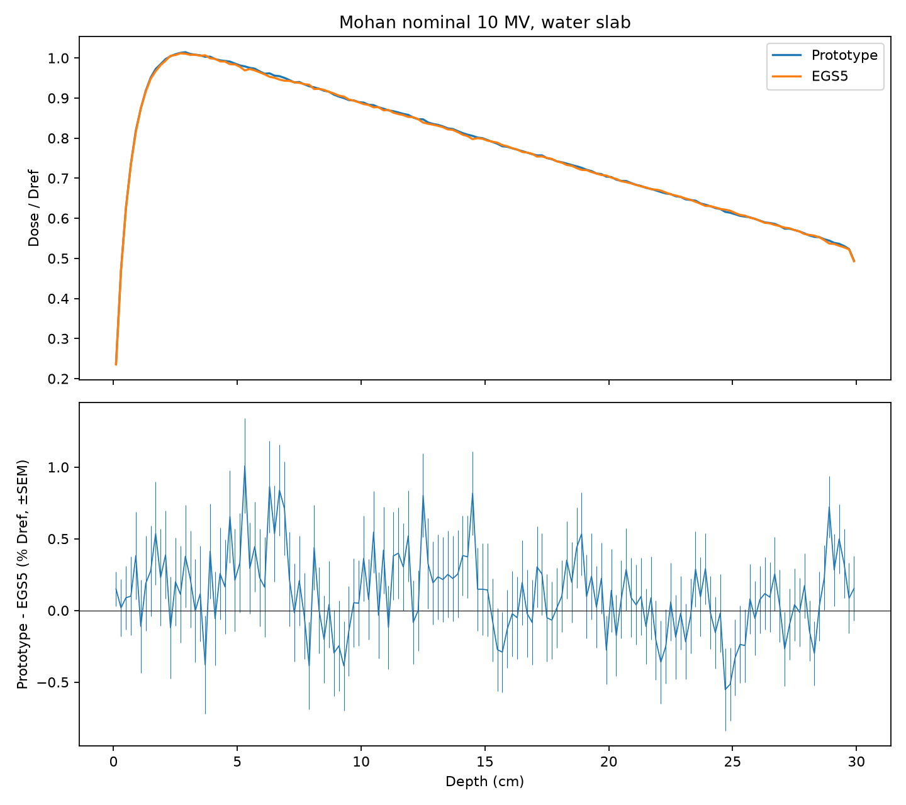

# P3a — Mohan公称10 MVスペクトル・水スラブ比較

## 予想

| 量 | 計算前の予想 | 結果 ± SEM | 単位 | 根拠 |
|---|---|---:|---|---|
| prototype dmax | 2〜3 cm | +2.900000 ± 0.106260 | cm | 探索的な予想。臨床の照射野・発散・混入電子の条件とは異なる。 |
| EGS5 dmax | 2〜3 cm | +2.700000 ± 0.237322 | cm | 探索的な予想。臨床の照射野・発散・混入電子の条件とは異なる。 |
| 全沈着/入射の試作−EGS5（相対） | −0.1〜+0.1% | +0.124601 ± 0.049372 | % | P2cの6・10 MeVの比。1.25 MeV未満は高エネルギー2点からの外挿。 |
| 深部ブロック 1 | ±0.3% Dref以内 | +0.188437 ± 0.124332 | % Dref | P2cの6・10 MeVで最大0.25%。 |
| 深部ブロック 2 | ±0.3% Dref以内 | +0.285821 ± 0.110126 | % Dref | P2cの6・10 MeVで最大0.25%。 |
| 深部ブロック 3 | ±0.3% Dref以内 | +0.071202 ± 0.113143 | % Dref | P2cの6・10 MeVで最大0.25%。 |
| 深部ブロック 4 | ±0.3% Dref以内 | -0.050820 ± 0.105867 | % Dref | P2cの6・10 MeVで最大0.25%。 |
| 深部ブロック 5 | ±0.3% Dref以内 | +0.060222 ± 0.097245 | % Dref | P2cの6・10 MeVで最大0.25%。 |
| ビルドアップ 試作−EGS5 | +0.1〜+0.4% Dref | +0.186120 ± 0.169785 | % Dref | P2cで両エネルギーとも約+0.25%。原因未確定。 |
| 飛行中/対生成の試作÷EGS5 | 0.98〜0.99 | +1.005209 ± 0.012667 | 比 | P2cで6 MeVが0.984、10 MeVが0.987。 |
| prototype 入射平均 | 2.8014 MeV | +2.802126 ± 0.000755 | MeV | スペクトルの定義。 |
| EGS5 入射平均 | 2.8014 MeV | +2.801215 ± 0.000710 | MeV | スペクトルの定義。 |

## 結果

固定した深部のブロック平均の差が1%以内

Dref = 9.79853508049e-12 Gy cm²（EGS5パイロットの5 bin移動平均の最大値）。

| 深部bin | 差 ± SEM (% Dref) | 状態 | |差|+1.96 SEM |
|---|---:|---|---:|
| 25〜49 | +0.188437 ± 0.124332 | 1%以内 | 0.432127 |
| 50〜74 | +0.285821 ± 0.110126 | 1%以内 | 0.501668 |
| 75〜99 | +0.071202 ± 0.113143 | 1%以内 | 0.292962 |
| 100〜124 | -0.050820 ± 0.105867 | 1%以内 | 0.258320 |
| 125〜149 | +0.060222 ± 0.097245 | 1%以内 | 0.250822 |

near: +0.174092 ± 0.154727% Dref（判定なし）。
buildup: +0.186120 ± 0.169785% Dref（判定なし）。

| コード | 全沈着/入射 ± SEM | 飛行中/対生成 ± SEM | 対生成 | 静止 | 飛行中 | 脱出 | 違反 | 未処理/失敗 | 秒 |
|---|---:|---:|---:|---:|---:|---:|---|---|---:|
| prototype | 0.508729180 ± 0.000185657 | 0.053231074 ± 0.000481880 | 233003 | 217195 | 12403 | 8021699 | [0, 0, 0] | [0, 0] | 3041.834 |
| EGS5 | 0.508096089 ± 0.000168492 | 0.052955221 ± 0.000464195 | 235803 | 219742 | 12487 | 8023708 | 0 | 0 | 766.541 |

## 考察

prototype dmax: 予想 2〜3 cm、結果 +2.900000 ± 0.106260 cm。スペクトルの電子飛程の重なりと表面からの脱出がピーク位置に影響する。臨床値との定量的比較はできない。
EGS5 dmax: 予想 2〜3 cm、結果 +2.700000 ± 0.237322 cm。スペクトルの電子飛程の重なりと表面からの脱出がピーク位置に影響する。臨床値との定量的比較はできない。
全沈着/入射の試作−EGS5（相対）: 予想 −0.1〜+0.1%、結果 +0.124601 ± 0.049372 %。低エネルギー光子の局所沈着、電子飛程、後方脱出の重みが単色から変わり、表面付近の輸送差も寄与しうる。
深部ブロック 1: 予想 ±0.3% Dref以内、結果 +0.188437 ± 0.124332 % Dref。スペクトルは低エネルギー成分とエネルギーごとに異なる電子飛程・対生成割合を重ねるため、単色の差からの予想には限界がある。陽電子の輸送近似と残ったビルドアップ差の原因は未確定。
深部ブロック 2: 予想 ±0.3% Dref以内、結果 +0.285821 ± 0.110126 % Dref。スペクトルは低エネルギー成分とエネルギーごとに異なる電子飛程・対生成割合を重ねるため、単色の差からの予想には限界がある。陽電子の輸送近似と残ったビルドアップ差の原因は未確定。
深部ブロック 3: 予想 ±0.3% Dref以内、結果 +0.071202 ± 0.113143 % Dref。スペクトルは低エネルギー成分とエネルギーごとに異なる電子飛程・対生成割合を重ねるため、単色の差からの予想には限界がある。陽電子の輸送近似と残ったビルドアップ差の原因は未確定。
深部ブロック 4: 予想 ±0.3% Dref以内、結果 -0.050820 ± 0.105867 % Dref。スペクトルは低エネルギー成分とエネルギーごとに異なる電子飛程・対生成割合を重ねるため、単色の差からの予想には限界がある。陽電子の輸送近似と残ったビルドアップ差の原因は未確定。
深部ブロック 5: 予想 ±0.3% Dref以内、結果 +0.060222 ± 0.097245 % Dref。スペクトルは低エネルギー成分とエネルギーごとに異なる電子飛程・対生成割合を重ねるため、単色の差からの予想には限界がある。陽電子の輸送近似と残ったビルドアップ差の原因は未確定。
ビルドアップ 試作−EGS5: 予想 +0.1〜+0.4% Dref、結果 +0.186120 ± 0.169785 % Dref。スペクトルは低エネルギー成分とエネルギーごとに異なる電子飛程・対生成割合を重ねるため、単色の差からの予想には限界がある。陽電子の輸送近似と残ったビルドアップ差の原因は未確定。
飛行中/対生成の試作÷EGS5: 予想 0.98〜0.99、結果 +1.005209 ± 0.012667 比。低エネルギーでは対生成と消滅までの競合が変わるため、6・10 MeVの割合の単純な外挿ではない。
prototype 入射平均: 予想 2.8014 MeV、結果 +2.802126 ± 0.000755 MeV。標本平均の揺らぎをSEMと併せて解釈する。
EGS5 入射平均: 予想 2.8014 MeV、結果 +2.801215 ± 0.000710 MeV。標本平均の揺らぎをSEMと併せて解釈する。

厚さ30 cmの水スラブ・平行ビームでの比較であり、10×10 cm²の照射野のPDD・側方分布ではない。
制動放射の光子を両コードとも運ばず、その場に沈着させている。
Fano試験、線量/衝突カーマ比の文献値との照合などの独立の検査は未実施。
判定は点推定を±1%と比べる。真の差が95%の確度で±1%以内という意味ではない。
5 cmのブロック平均の一致は、深さ線量の局所的な一致までは示さない。
電子のカットオフは試作が10 keV、EGS5が約10.001 keVで、乱数の生成器も異なる。
陽電子にも電子の阻止能・硬衝突・弾性散乱を使う近似が残る。
スペクトルの値そのものは報告に載せない。
割合のSEMは100バッチの分子と分母の共分散を含む残差式。独立な両コード間の比は誤差伝播。
