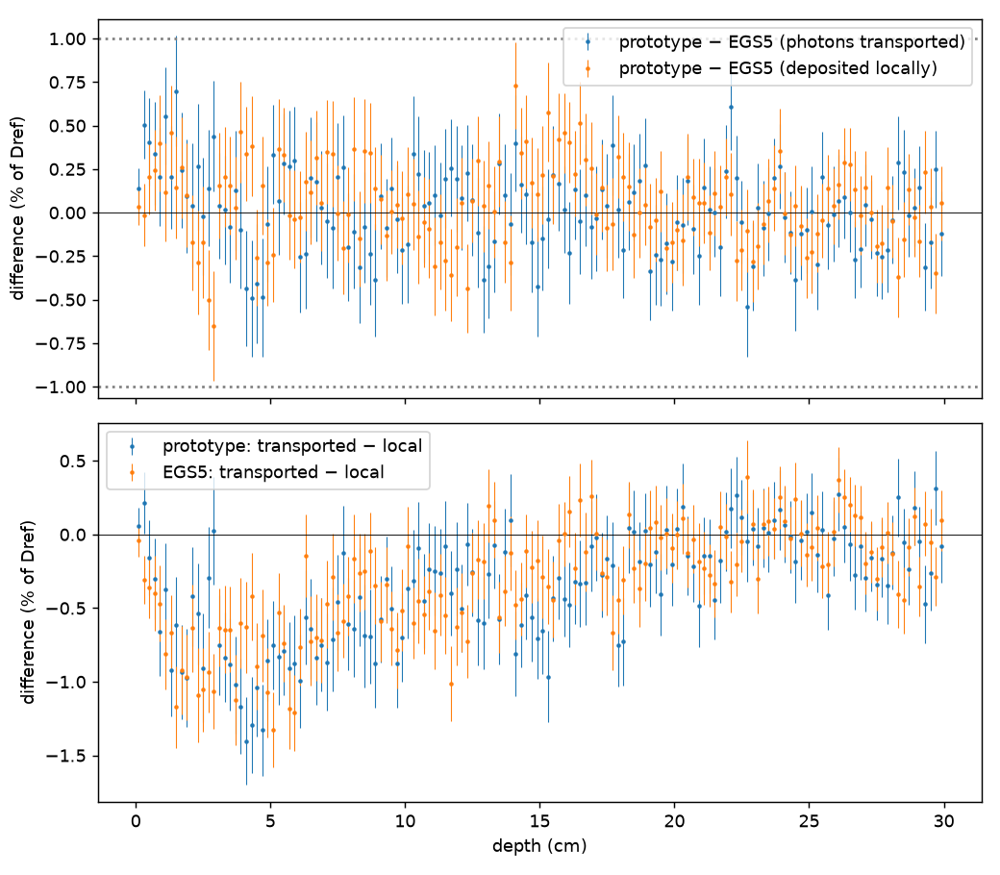

# P3r: 制動放射の光子を運ぶ — 結果

計画: `docs/ai/plans/2026-10-12-mv-p3r-bremsstrahlung-transport.md`（追補1〜3を含む）。考察は[DISCUSSION.md](DISCUSSION.md)。
条件: 水スラブ30 cm、Mohan 10 MVスペクトルの平行ビーム、各1000万履歴・100バッチ。値は固定した`Dref`（P3aの`pilot_lock.json`）に対する%、±はSEM。

## 判定

| 記号 | 内容 | 結果 |
|---|---|---|
| R1（主） | 光子を運ぶ設定で、試作 − EGS5 が深部5ブロックで1%以内、かつSEM 0.33%以下 | **固定した深部のブロック平均の差が1%以内** |
| R2（副） | 光子を運ぶことによる変化の、両コードの差（差の差） | **変化は1%以内で同じ** |

## 深部5ブロック

| 深さ | R1: 試作 − EGS5（運ぶ） | R2: 差の差 | 試作: 運ぶ − その場 | EGS5: 運ぶ − その場 |
|---|---|---|---|---|
| 5.0〜10.0 cm | +0.00 ± 0.13 | -0.10 ± 0.17 | -0.68 ± 0.13 | -0.58 ± 0.10 |
| 10.0〜15.0 cm | +0.04 ± 0.11 | +0.03 ± 0.15 | -0.35 ± 0.11 | -0.38 ± 0.10 |
| 15.0〜20.0 cm | -0.01 ± 0.10 | -0.16 ± 0.14 | -0.30 ± 0.11 | -0.14 ± 0.09 |
| 20.0〜25.0 cm | -0.02 ± 0.09 | -0.00 ± 0.13 | -0.03 ± 0.10 | -0.03 ± 0.09 |
| 25.0〜30.0 cm | -0.04 ± 0.09 | -0.03 ± 0.12 | -0.09 ± 0.09 | -0.06 ± 0.08 |
| ピークの窓（参考） | -0.06 ± 0.16 | -0.04 ± 0.21 | -0.86 ± 0.16 | -0.82 ± 0.13 |
| ビルドアップ（参考） | +0.39 ± 0.16 | +0.18 ± 0.21 | -0.43 ± 0.16 | -0.61 ± 0.14 |

「その場」は、試作はモード1（離散・その場に沈着、`p3r_proto_local`）、EGS5は既存の2本（`p3a_egs`、`p3a_egs_seed2`）の平均。

## R3: 放射損失を離散にしただけの効果（合否なし）

| 深さ | 離散・その場 − EGS5その場 | 離散・その場 − 連続（`p3s_own`） | 連続 − EGS5その場 |
|---|---|---|---|
| 5.0〜10.0 cm | +0.10 ± 0.11 | +0.19 ± 0.12 | -0.09 ± 0.10 |
| 10.0〜15.0 cm | +0.01 ± 0.10 | -0.04 ± 0.11 | +0.05 ± 0.10 |
| 15.0〜20.0 cm | +0.15 ± 0.10 | +0.03 ± 0.11 | +0.12 ± 0.09 |
| 20.0〜25.0 cm | -0.02 ± 0.10 | +0.15 ± 0.10 | -0.17 ± 0.08 |
| 25.0〜30.0 cm | -0.00 ± 0.08 | -0.08 ± 0.10 | +0.07 ± 0.09 |
| ピークの窓 | -0.02 ± 0.14 | -0.06 ± 0.16 | +0.03 ± 0.13 |
| ビルドアップ | +0.21 ± 0.15 | -0.06 ± 0.16 | +0.27 ± 0.14 |

## その他の量

| 量 | 試作（運ぶ） | 試作（離散・その場） | 試作（連続） | EGS5（運ぶ） | EGS5（その場、2本） |
|---|---|---|---|---|---|
| スラブ全体の沈着 ÷ 入射 | 0.50615 ± 0.00016 | 0.50853 | 0.50833 | 0.50623 ± 0.00016 | 0.50810、0.50826 |
| 制動放射の回数（1履歴あたり、全世代） | 0.07623 | 0.07609 | — | 0.07676 | — |
| 発生エネルギー（MeV/履歴） | 0.01396 | 0.01398 | — | 0.01413 | — |
| 計算時間（µs/履歴。本計算の実測） | 317 | 308 | 225 | 78 | — |

- 回数の差（試作 − EGS5、運ぶ設定）: -0.69 ± 0.17%。発生エネルギーの差: -1.23 ± 0.39%。発生エネルギーは計画の目安（1%）を超えた。回数の差も約4σある。原因は未解明（DISCUSSIONの4節。式と対生成の数の差は主な原因でないことまで確認）。
- 対生成の回数（1履歴あたり）: 試作 0.02330、EGS5 0.02363（−1.4%。P3aで分かっている差と同じ向き・同じ大きさ）。

## EGS5によらない確認（`checks.json`。全項目合格）

| 記号 | 内容 | 結果 |
|---|---|---|
| G1 | 頻度・離散の阻止能・連続の放射阻止能を別の積分と照合（23点） | 合格。節点での「離散＋連続 = ESTAR」のずれは最大 2.2e-16 |
| G2 | 光子エネルギーの採取（T = 0.02、0.1、1、10 MeV、各100万個） | 合格。p = 0.27, 0.20, 0.81, 0.42 |
| G3 | 発生の回数とエネルギー（10 MeV電子、20万履歴、175998回） | 合格。z = +0.21（回数）、-0.10（エネルギー） |
| G4 | 光子の向き | 合格（追補1。最初の試行は−z向きの方位角が p = 0.00095 で不合格。同じseedの一様乱数そのものが同じ p になる偶然で、seedを替えてやり直した。やり直しの p = 0.63, 0.34, 0.24） |
| G5 | 収支（3モード、Mohan 2万履歴） | 合格。残差は最大1e-14程度 |
| G6 | モード0がP3sと完全一致 | 合格 |
| G6b | 写した輸送ループで離散事象を切るとP3sと一致 | 合格（完全一致。相対差0） |
| G7 | 放射収率（無限の水） | 3エネルギーとも「異常なし」。2 MeV 0.736%（CSDA 0.708%、差 +3.8%）、5 MeV 1.977%（+3.4%）、10 MeV 4.226%（+3.8%）。追補2で2 MeVの履歴数を80万に増やした |
| G8 | 10.1〜100 keVの光子の透過率と最初の反応 | 合格。8個の検定の p = 0.11〜0.92。追補3でスラブの厚さを0.2 cmの倍数にした |
| EGS | EGS5の利用者コードの中断・再開（1万履歴） | 合格。止めずに走らせた結果と完全一致 |

## 経過の記録（留意点）

- Codexは断面積・輸送ループ・EGS5の利用者コード・テスト34件を書いた時点で利用上限により停止した。`run_p3r.py`の確認・本計算・解析の部分はClaudeが書いた（独立な目で検証されていない部分）。
- 確認は3回止まり、追補1〜3でやり直した（`checks_attempt{1,2,3}.json`に各時点の記録）。追補1はユーザーの承認、追補2・3はClaudeの判断。3回とも線量の結果が出る前で、判定の条件は変えていない。追補2（履歴数の見積もり漏れ）と追補3（厚さがビン幅の倍数でない）は計画・検査の組み方の不備。
- 判定は固定したブロック平均の点推定と±1%の比較である。厚さ30 cmの水スラブ・広い平行ビームでの結果で、照射野のあるPDD/OCRではない。

## 解析部分の独立レビュー（2026-10-12、判定のあとに実施）

`run_p3r.py`の確認・本計算・解析の部分はClaudeが書いたので、Codexに独立なレビューを依頼した（原文: `docs/ai/plans/reviews/2026-10-12-mv-p3r-review3-codex-analysis-code.md`）。Codexは生の結果から領域平均・差・SEMを計算し直し、`analysis.json`との差は最大1e-16、**R1・R2の判定は変わらない**と確認した。RESULTSの表の数値と元のJSONの不一致もなかった。

指摘と対応（`run_p3r.py`は保存した設定にハッシュが入っているので書き換えず、`supplementary/review3_followup.{py,json}`で補った）:

| 指摘 | 対応と結果 |
|---|---|
| 判定領域の固定ファイルと、解析に使った各計算の設定を、解析の前に照合していない（別の条件の結果が置かれても気づけない） | 補足のスクリプトで照合した。固定ファイルはP3sの解析時と同じハッシュ。6本の計算の履歴数・seed・スペクトル・設定はすべて期待どおり。**今回の成果物に取り違えはない。** 関門そのものが弱い点は、次に`run_`系のスクリプトを書くときに直す |
| 相対差のSEMに係数が抜けている | 直すと、回数 −0.69 ± 0.167%（表示は±0.17のまま）、発生エネルギー −1.23 ± 0.388%（±0.39のまま） |
| G3のSEMが標本分散の補正（n−1）を省いている | 直すと z = +0.20619、−0.09583。変化は6桁目で、合否は変わらない |
| 計画にある「外へ逃げたエネルギー」が報告されていない | 下の表 |
| 同時2プロセスの上限をスクリプトが強制していない | 今回は起動用のスクリプトで2本までにした。仕組みとしては未対応 |

外へ逃げたエネルギー ÷ 入射エネルギー（±はSEM）:

| 試作（運ぶ） | 試作（離散・その場） | 試作（連続） | EGS5（運ぶ） | EGS5（その場、2本） |
|---|---|---|---|---|
| 0.49373 ± 0.00016 | 0.49135 ± 0.00016 | 0.49154 ± 0.00018 | 0.49377 ± 0.00016 | 0.49190、0.49174（各 ± 0.00017） |

光子を運ぶと、逃げる割合は試作で +0.0024、EGS5で +0.0019〜0.0020 増える（入射エネルギーに対して）。運ぶ設定どうしの差は −0.00004 ± 0.00023 で、一致している。
