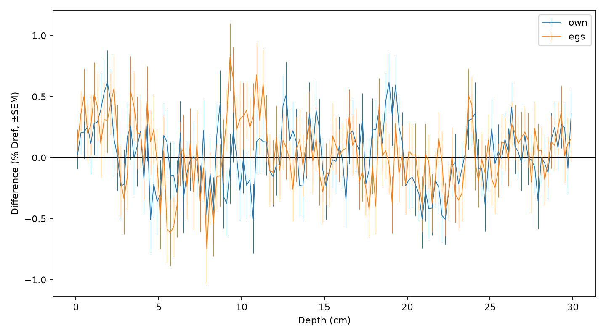
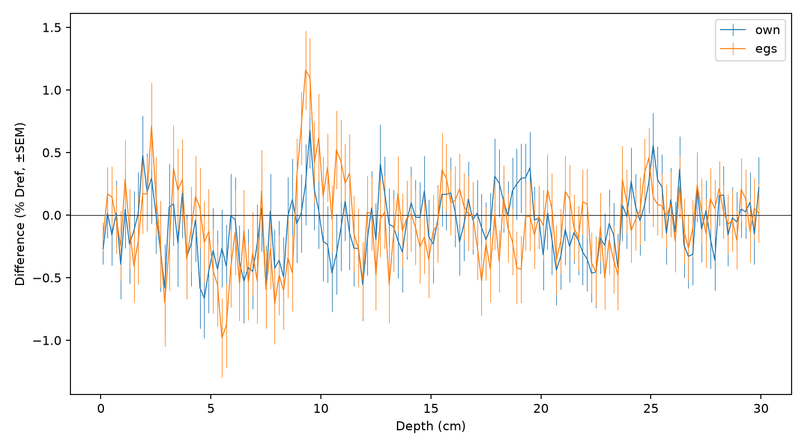

# P3s 結果

## 予想

| 量 | 計算前の予想 | 結果 ± SEM | 根拠 |
|---|---|---|---|
| const 採点なし時間 | 約300 µs/履歴 | 300.454 ± 2.808 µs/履歴 | 計画0節の実測と採点を切る効果 |
| const 全ステップ/履歴 | 約1200 | 1210.105 ± 0（同じseedで2回） | 計画0節の実測 |
| own 採点なし時間 | 約220 µs/履歴 | 195.877 ± 0.055 µs/履歴 | 計画0節の実測と採点を切る効果 |
| own 全ステップ/履歴 | 約700 | 654.541 ± 0（同じseedで2回） | 計画0節の実測 |
| egs 採点なし時間 | 約200 µs/履歴 | 205.627 ± 1.020 µs/履歴 | 計画0節の実測と採点を切る効果 |
| egs 全ステップ/履歴 | 約650 | 558.545 ± 0（同じseedで2回） | 計画0節の実測 |
| 電子 2.0 MeV own 深さ | 可（仮説） | 統計不足、最大絶対差 0.267319% Dref、最大3SEM 0.637473% | 粗くする領域で刻みが短いが、保証ではない |
| 電子 2.0 MeV own 横 | 可（仮説） | +0.176573 ± 0.165167%、可 | 計画5.2の事前仮説 |
| 電子 6.0 MeV own 深さ | 可（仮説） | 統計不足、最大絶対差 0.482062% Dref、最大3SEM 0.723862% | 粗くする領域で刻みが短いが、保証ではない |
| 電子 6.0 MeV own 横 | 可（仮説） | +0.111959 ± 0.165321%、可 | 計画5.2の事前仮説 |
| 電子 10.0 MeV own 深さ | 可（仮説） | 統計不足、最大絶対差 0.381577% Dref、最大3SEM 0.703312% | 粗くする領域で刻みが短いが、保証ではない |
| 電子 10.0 MeV own 横 | 可（仮説） | +0.201694 ± 0.180153%、可 | 計画5.2の事前仮説 |
| 電子 2.0 MeV egs 深さ | 可（仮説） | 統計不足、最大絶対差 0.552639% Dref、最大3SEM 0.674863% | 粗くする領域で刻みが短いが、保証ではない |
| 電子 2.0 MeV egs 横 | 可（仮説） | +0.401219 ± 0.152444%、可 | 計画5.2の事前仮説 |
| 電子 6.0 MeV egs 深さ | 可（仮説） | 統計不足、最大絶対差 0.495348% Dref、最大3SEM 0.706839% | 粗くする領域で刻みが短いが、保証ではない |
| 電子 6.0 MeV egs 横 | 可（仮説） | -0.016847 ± 0.160879%、可 | 計画5.2の事前仮説 |
| 電子 10.0 MeV egs 深さ | 可（仮説） | 統計不足、最大絶対差 0.487695% Dref、最大3SEM 0.720955% | 粗くする領域で刻みが短いが、保証ではない |
| 電子 10.0 MeV egs 横 | 可（仮説） | +0.040919 ± 0.170042%、可 | 計画5.2の事前仮説 |
| own − 現行 深部ブロック1 | ±0.2% Dref以内（統計の範囲） | -0.158568 ± 0.127309% Dref | P2の半刻み比較 |
| own − 現行 深部ブロック2 | ±0.2% Dref以内（統計の範囲） | -0.113978 ± 0.110142% Dref | P2の半刻み比較 |
| own − 現行 深部ブロック3 | ±0.2% Dref以内（統計の範囲） | +0.067942 ± 0.107154% Dref | P2の半刻み比較 |
| own − 現行 深部ブロック4 | ±0.2% Dref以内（統計の範囲） | -0.156746 ± 0.101209% Dref | P2の半刻み比較 |
| own − 現行 深部ブロック5 | ±0.2% Dref以内（統計の範囲） | +0.012434 ± 0.098277% Dref | P2の半刻み比較 |
| egs − 現行 深部ブロック1 | ±0.2% Dref以内（統計の範囲） | -0.176938 ± 0.130047% Dref | P2の半刻み比較 |
| egs − 現行 深部ブロック2 | ±0.2% Dref以内（統計の範囲） | -0.036234 ± 0.115979% Dref | P2の半刻み比較 |
| egs − 現行 深部ブロック3 | ±0.2% Dref以内（統計の範囲） | -0.082167 ± 0.107039% Dref | P2の半刻み比較 |
| egs − 現行 深部ブロック4 | ±0.2% Dref以内（統計の範囲） | -0.063045 ± 0.106305% Dref | P2の半刻み比較 |
| egs − 現行 深部ブロック5 | ±0.2% Dref以内（統計の範囲） | +0.016700 ± 0.090354% Dref | P2の半刻み比較 |
| egs − EGS5平均 ビルドアップ | ユーザー: 現行より0に近づく。Claude: 変化0.1%未満で識別困難の可能性 | +0.329372 ± 0.145426% Dref | 差の原因は未確定、事前のSEM約0.15% |

## 結果

### 結果を変えない高速化の効果

S1・S2: 完全一致。元の採点あり 286.142、const採点なし 300.454 µs/履歴。

### 刻みの変更による線量の変化とEGS5との差

| 規則・比較 | 深部bin | 差 ± SEM (% Dref) | 判定 | |差|+1.96 SEM |
|---|---|---:|---|---:|
| own vs_EGS5 | 25〜49 | -0.087962 ± 0.096452 | 1%以内 | 0.277009 |
| own vs_EGS5 | 50〜74 | +0.049326 ± 0.095322 | 1%以内 | 0.236157 |
| own vs_EGS5 | 75〜99 | +0.122461 ± 0.092127 | 1%以内 | 0.303029 |
| own vs_EGS5 | 100〜124 | -0.167232 ± 0.084084 | 1%以内 | 0.332036 |
| own vs_EGS5 | 125〜149 | +0.070829 ± 0.088376 | 1%以内 | 0.244045 |

own: 固定した深部のブロック平均の差が1%以内。

| own vs_current | 25〜49 | -0.158568 ± 0.127309 | 1%以内 | 0.408093 |
| own vs_current | 50〜74 | -0.113978 ± 0.110142 | 1%以内 | 0.329856 |
| own vs_current | 75〜99 | +0.067942 ± 0.107154 | 1%以内 | 0.277963 |
| own vs_current | 100〜124 | -0.156746 ± 0.101209 | 1%以内 | 0.355117 |
| own vs_current | 125〜149 | +0.012434 ± 0.098277 | 1%以内 | 0.205058 |

own: 刻みの変更による差が1%以内。

| egs vs_EGS5 | 25〜49 | -0.106332 ± 0.100039 | 1%以内 | 0.302408 |
| egs vs_EGS5 | 50〜74 | +0.127071 ± 0.102011 | 1%以内 | 0.327012 |
| egs vs_EGS5 | 75〜99 | -0.027648 ± 0.091993 | 1%以内 | 0.207954 |
| egs vs_EGS5 | 100〜124 | -0.073531 ± 0.090153 | 1%以内 | 0.250230 |
| egs vs_EGS5 | 125〜149 | +0.075095 ± 0.079470 | 1%以内 | 0.230857 |

egs: 固定した深部のブロック平均の差が1%以内。

| egs vs_current | 25〜49 | -0.176938 ± 0.130047 | 1%以内 | 0.431830 |
| egs vs_current | 50〜74 | -0.036234 ± 0.115979 | 1%以内 | 0.263553 |
| egs vs_current | 75〜99 | -0.082167 ± 0.107039 | 1%以内 | 0.291963 |
| egs vs_current | 100〜124 | -0.063045 ± 0.106305 | 1%以内 | 0.271403 |
| egs vs_current | 125〜149 | +0.016700 ± 0.090354 | 1%以内 | 0.193794 |

egs: 刻みの変更による差が1%以内。

| 比較 | ビルドアップ (% Dref) | 表面〜15 cm (% Dref) | 全沈着/入射の相対差 (%) |
|---|---:|---:|---:|
| 現行 − EGS5平均 | +0.387776 ± 0.140961 | +0.157966 ± 0.056857 | +0.108445 ± 0.043336 |
| own − EGS5平均 | +0.272430 ± 0.140191 | +0.025026 ± 0.053542 | +0.030147 ± 0.042873 |
| egs − EGS5平均 | +0.329372 ± 0.145426 | +0.082731 ± 0.057294 | +0.050853 ± 0.042573 |
| egs − 現行 | -0.058403 ± 0.160106 | -0.075235 ± 0.069272 | -0.057530 ± 0.050964 |

| 条件 | µs/履歴 | ステップ/履歴 |
|---|---:|---:|
| S5 original | 286.142 | 1210.105 |
| S5 const | 300.454 | 1210.105 |
| S5 own | 195.877 | 654.541 |
| S5 egs | 205.627 | 558.545 |
| 本計算 p3s_own | 224.572 | 651.210 |
| 本計算 p3s_egs | 230.331 | 558.475 |

## 考察

採点整理の効果はS1・S2の完全一致とS5の時間で確認する。刻み変更の効果はS4と現行との差で、EGS5との差は独立に読む。
予想と結果は値とSEMを併せて読む。差の原因を刻みだけに帰することはできず、ビルドアップの仮説は結果の不確かさに制限される。
深部の判定は固定したブロック平均についてのもので、ブロック内部の正負の差が打ち消し合っても合格になる。
判定は点推定と±1%の比較であり、真の差が95%の確度で1%以内という意味ではない。
S4は現行との変更前後の比較であり、より細かい刻みへの収束検査ではない。光子由来電子の初期状態や陽電子を直接には検査していない。
egsはK1.datに基づく研究用の対照であり、EGS5の電子輸送全体の再現ではない。
S5と本計算のステップ定義はchecks.jsonを参照。厚さ30 cmの水スラブでの検証である。
