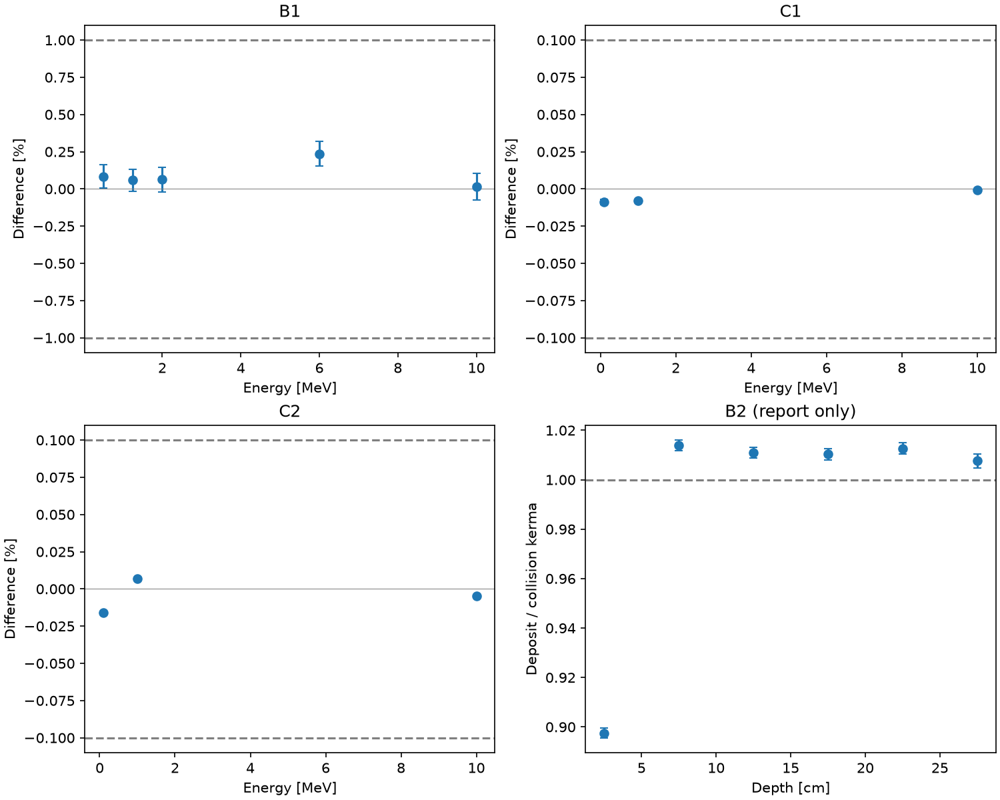

# P4b・P4c 結果: 衝突カーマの総和、連続減速の飛程

- 日付: 2026-10-14
- 計画: [2026-10-13-mv-p4bc-kerma-range.md](../../../ai/plans/2026-10-13-mv-p4bc-kerma-range.md)（追補1・2あり）
- 機械可読: `checks_p4bc.json`、`lock_p4bc.json`（試し計算と本番の粒子数）、`fetch_p4bc.json`・`estar_range_water.html`（NISTの応答そのもの）
- EGS5は使っていない。既存の核は1行も変えていない。

## 結論

事前に固定した11個（B1の5個、C1の3個、C2の3個）はすべて合格した。

| 検査 | 量 | 結果 | 許容 |
|---|---|---|---|
| B1 | 無限の水で、NISTの μen/ρ による衝突カーマの総和 ÷ 入射エネルギー − 1（0.5 / 1.25 / 2 / 6 / 10 MeV） | +0.08 / +0.06 / +0.06 / +0.24 / +0.02 %（SEM 0.07〜0.09 %） | 差1 %、SEM 0.1 % |
| C1 | 輸送で得た飛程 ÷ 阻止能の数値積分 − 1（0.1 / 1 / 10 MeV） | −0.009 / −0.008 / −0.001 %（SEM 0.002 % 以下） | 0.1 % |
| C2 | 阻止能の数値積分 ÷ ESTARの飛程の表 − 1 | −0.016 / +0.007 / −0.005 % | 0.1 % |

表の値は、Claudeが保存データから別に計算し直して一致を確かめた（B1の5個とB2）。

## 考察

- **B1**: 試作が制動放射として放出したエネルギー（事象として数えた分と連続の損失の合計、核の集計 `brems[8]`）は、入射の 0.07 / 0.20 / 0.36 / 1.40 / 2.58%（0.5 / 1.25 / 2 / 6 / 10 MeV。同じ光子の子孫が再び放射する分も含む。飛行中の消滅で光子に戻る陽電子の運動エネルギーは含まない）。10 MeVで放射の扱いに1割の誤りがあれば、B1は約0.26%動く。結果は +0.02 ± 0.09% なので、その水準の誤りは無いと言える。低いエネルギーでは放射そのものが小さいので、B1は主に「飛跡の長さによるカーマの集計」と「μen/ρ の表・補間」の検査になる。
- 5個とも差は正で、統計誤差で重みをつけた平均は +0.09 ± 0.04%（統計誤差の2.6倍）。5個が共通の値を持つとしたときのばらつきは χ² = 4.3（自由度4）で、エネルギーによる違いは見えていない。6 MeVの +0.24 ± 0.08% も、この共通のずれ +0.09% から見れば統計誤差の1.8倍である。したがって、放射の割合に比例する誤り（それなら10 MeVで最大になる）よりも、エネルギーによらない小さなずれ（表の補間や係数の体系の違い）のほうが結果に合う。原因は切り分けていない。
- 0.5 MeVで `ρ_tr − ρ_col` が −0.09% なのは、放射がほとんど無い領域で、試作の μtr による総和がNISTの μen による総和よりわずかに小さいことを示す。上の共通のずれ（+0.09%）と同じ大きさで、係数の体系の違い（候補: Comptonの束縛の扱い、表の補間）の目安になる。確かめてはいない。`ρ_tr − ρ_col` は係数の差の飛跡積分であって、直接数えた放射エネルギーではない。
- 10 keV未満の光子をカーマに数えない効果と、10 keV未満の制動放射を連続の損失にする効果（入射の0.014〜0.021%）は、どちらも負の方向なので、正のずれの説明にはならない。
- ずれは許容（1%）の1/4以下で、判定には影響しない。
- **C1** は、Codexがヒンジの式から事前に計算した値（−0.007 / −0.008 / −0.0002%）と統計誤差の範囲で一致した。エネルギーのヒンジによる刻みの積み上げは、阻止能の積分を0.01%で再現する。
- **C2** は、試作の阻止能（Berger–Seltzerの衝突の式 + ESTARの放射阻止能の補間）が、NISTの飛程の表と0.02%以内で整合することを示す。
- **B2（報告のみ）**: Mohanの10 MVスペクトルの平板で、線量 ÷ 衝突カーマは深さ5〜25 cmで 1.010〜1.014（各 ±0.002）、5〜25 cmをまとめると 1.0120 ± 0.0012。25〜30 cmは 1.008 ± 0.003（裏面の手前）。0〜5 cmはビルドアップを含むので 0.898。「1をわずかに上回り、ほぼ一定」という過渡的な荷電粒子平衡の見込みと合う。文献の数値とは照合していない。

## この検査で言えないこと

- B1は、断面積と放射阻止能の出典の一部がNISTの表と共通で、完全に独立な物理モデルの検査ではない。期待値の検査であり、深さ方向や横方向の分布は検査しない。骨子にあった「相互作用の点で渡したエネルギーとの一致」（B3）は行っていない。
- C1はP1の電子の核（硬衝突を切れる唯一の核）で行った。エネルギーのヒンジの式は後の核に引き継がれているが、いまの核のループそのものを動かした検査ではない。
- 公表された測定値との照合は行っていない（ユーザー決定）。

## 経緯の記録

- 追補1: 3段階が同じ結果ファイルに書き足す設計が「上書きしない」と両立せず、Codexが止まって報告した。段階ごとに別のファイルへ1度だけ書く形に直した。
- 追補2: NISTのサイトがPython標準の通信に403を返し、応答の表の形もCodexの置いた前提と違った。`curl` に変え、読み取りを実際の形に合わせた（Claude）。
- どちらも計算を動かす前の修正で、読み取る値・式・許容・種は変えていない。
- 実装はCodex、差分の確認・取得・実行・数値の再計算はClaude。Codexレビューは詳細1巡（致命0・実質2）。

以下は `run_p4bc analyse` が生成した表である。

P4bは断面積と放射阻止能の出典の一部が共通で、完全に独立な物理モデルではない。
10 keV未満の光子は負の方向に寄与するが、寄与の大きさは分離していない。連続制動放射、荷電粒子のカットオフ、原子緩和、束縛のないCompton、陽電子の近似、NISTのgに含まれる効果もあり、差を一つの原因に帰さない。
ρ_tr−ρ_colは試作のμtrとNISTのμenの差の飛跡積分で、直接数えた放射エネルギーではない。B3は未実施であり、B1の合格はB3の検証を意味しない。
P4cはP1の核による検査で、現在の核のループそのものの検査ではない。C1の0.05%刻みの積分誤差は最大0.025%で、SEMとは別。

B1は期待値の検査であり履歴ごとの恒等式ではない。許容1%、SEM上限0.1%。
C1/C2の許容は0.1%、C1のSEM上限は0.1%/3。許容・種・点は変更していない。

## B1（本番のみ判定。試し計算は粒子数の決定用）

| E MeV | 本番N | 差 % | SEM % | 判定 | 試し差 % | 試しSEM % | 本番秒 | 試し秒 |
|---|---|---|---|---|---|---|---|---|
| 0.5 | 500000 | 0.08348459 | 0.077649031 | 合格 | 0.19347848 | 0.17908723 | 159.10191 | 39.790272 |
| 1.25 | 600000 | 0.058166903 | 0.074275241 | 合格 | -0.15933537 | 0.19515621 | 260.15659 | 44.868658 |
| 2.0 | 600000 | 0.062586677 | 0.084276751 | 合格 | 0.46532151 | 0.19686809 | 321.42865 | 55.538818 |
| 6.0 | 900000 | 0.2366502 | 0.081133046 | 合格 | 0.34553743 | 0.23786913 | 917.54986 | 105.82845 |
| 10.0 | 900000 | 0.015727757 | 0.088267264 | 合格 | 0.22781719 | 0.24193881 | 1334.117 | 150.83196 |

### B1 報告のみ

| E MeV | ρ_col | ρ_tr | ρ_tr−ρ_col | 連続制動放射 / 入射 |
|---|---|---|---|---|
| 0.5 | 1.0008348 | 0.99996004 | -0.00087480834 | 0.00013519855 |
| 1.25 | 1.0005817 | 1.0017203 | 0.0011386678 | 0.00016414312 |
| 2.0 | 1.0006259 | 1.0029571 | 0.0023311834 | 0.00017714223 |
| 6.0 | 1.0023665 | 1.0161804 | 0.013813927 | 0.00020118 |
| 10.0 | 1.0001573 | 1.0289353 | 0.028777985 | 0.00020859663 |

負の差は低エネルギー光子の局所沈着の寄与と符号が整合するが、その大きさは分離していないため、差全体の説明にはならない。正の差にはこの負の寄与以外の効果が必要であり、原因は確定しない。

## B2（報告のみ）

1をわずかに上回りほぼ一定という見込みは仮説であり、合否は判定しない。

| 深さ cm | Σ線量 / Σ衝突カーマ | バッチ比のSEM | 状態 |
|---|---|---|---|
| 0–5 | 0.89753669 | 0.0019275291 | 報告のみ |
| 5–10 | 1.0138515 | 0.002196539 | 報告のみ |
| 10–15 | 1.0108631 | 0.0021363267 | 報告のみ |
| 15–20 | 1.0103144 | 0.0022289265 | 報告のみ |
| 20–25 | 1.0126963 | 0.0023611667 | 報告のみ |
| 25–30 | 1.0075963 | 0.0028345454 | 報告のみ |

B2計算時間: 578.81526 s

## C1・C2

| 検査 | E MeV | 差 % | SEM % | 判定 |
|---|---|---|---|---|
| C1 | 0.1 | -0.008825 | 0.0017398753 | 合格 |
| C1 | 1.0 | -0.008075 | 0.00081988814 | 合格 |
| C1 | 10.0 | -0.0007 | 0.00063177775 | 合格 |
| C2 | 0.1 | -0.01604348 | 0 | 合格 |
| C2 | 1.0 | 0.0067573819 | 0 | 合格 |
| C2 | 10.0 | -0.0048082905 | 0 | 合格 |

### 積分・ヒンジ（報告のみ）

水の密度1 g/cm³。飛程はcm（質量飛程では数値的にg/cm²と同じ）。

| E MeV | R_int cm | 積分倍点数の相対変化 | ヒンジ平均 cm | 分散 cm² | 平均の差 % | C1計算秒 |
|---|---|---|---|---|---|---|
| 0.1 | 0.014056245 | 2.2861055e-09 | 0.014055238 | 8.9601739e-10 | -0.0071607445 | 4.5460553 |
| 1.0 | 0.43647799 | 4.2922236e-09 | 0.43644092 | 4.421549e-08 | -0.0084927941 | 1.7601175 |
| 10.0 | 4.9745093 | 5.9435861e-09 | 4.9744992 | 1.931841e-06 | -0.00020261533 | 2.4615811 |

C1の区間内分布による積分誤差は最大0.025%。上表のSEMには含めない。

C2参照: {"metadata": {"fields": {"Energies": "", "ShowDefault": "on", "matno": "276"}, "retrieved_utc": "2026-10-13T13:57:27.648923+00:00", "sha256": "bd46b13b709c5c84b439db94b406400b81737a68f9327f6b5fca5711703fe9e6", "url": "https://physics.nist.gov/cgi-bin/Star/e_table-t.pl"}, "status": "取得済み"}

C2不合格の場合、阻止能の補間・密度効果の表・放射阻止能が検討対象となる。この比較だけでは寄与を分離できず、許容は変更しない。

総計算時間（保存済み計算分を含む）: 3976.7952 s

