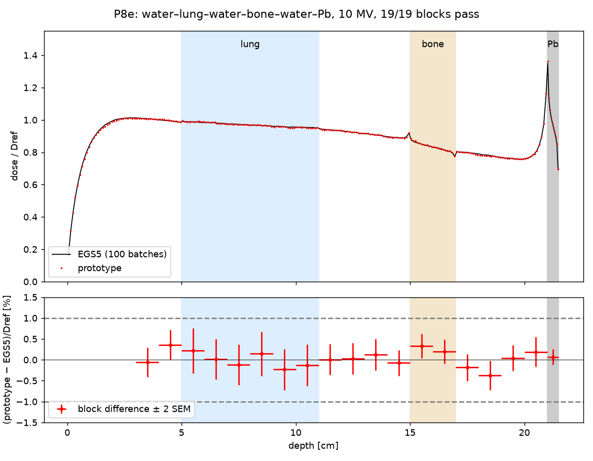

# P8e — 水・肺・骨・鉛の積層 1 構成の EGS5 比較（結果）

- 計画: [2026-10-20-mv-p8e-stack.md](../../../ai/plans/2026-10-20-mv-p8e-stack.md)（追補 1 と判定のコードのレビューの記録を含む）。骨子の組み直し（P8b〜P8d を省く、ユーザー決定 2026-10-20）: [P8 骨子の追補](../../../ai/plans/2026-10-19-mv-p8-heterogeneity.md)
- 数値: [judgement.json](judgement.json)、EGS5 [egs_production.json](egs_production.json)、試作 [proto_production.json](proto_production.json)、履歴数 [proto_allocation.json](proto_allocation.json)、CSDA [csda.json](csda.json)。図: [p8e_depth_dose.png](p8e_depth_dose.png)（`plot_p8e.py`）

## 結論

**事前に登録した 19 ブロックすべてが合格した**（|差| ≤ 1% かつ SEM ≤ 0.33%、`Dref` 比）。上流から順に判定し、不合格・統計不足はなかった。差の最大は水 18〜19 cm の −0.376 ± 0.176%、鉛の層は +0.069 ± 0.096%。

この結果が言えるのは、**この 1 構成（横方向に無限の積層、Mohan 10 MV の平行ビーム、深さの 1 cm ブロック平均と鉛の層の平均）で、試作と EGS5 の差が基準 v2 の範囲に入った**ことまで。同等性の検定ではなく、ビルドアップ・境界の近くの bin・照射野・単体の板は判定していない。

## 配置と計算

| 層 | 水 | 肺 0.26 | 水 | 骨 1.85 | 水 | 鉛 11.35 |
|---|---|---|---|---|---|---|
| 深さ (cm) | 0–5 | 5–11 | 11–15 | 15–17 | 17–21 | 21–21.5 |

- 蛍光は両方で入れた（EGS5 `iedgfl=iauger=1`、試作は K・L 殻の蛍光の緩和）。境界の扱いは (a)（持ち越しを打ち切って新しい材料で始め直す）。
- EGS5: 6×10⁷ 履歴、seed 820001、CPU 5,632 秒。エネルギーの収支は全体 2.0×10⁻¹³、履歴ごとの最大 4.7×10⁻⁸（許容 10⁻⁶）。全領域・全媒質の設定を hatch のあとの出力で照合した。
- 試作（CPU の Numba、2 プロセス）: 8,564,600 履歴（試し計算 10⁶ 履歴から、最も統計の悪い肺 5〜6 cm のブロックで決めた。1.5 倍の余裕）、11,193 秒。履歴ごとの収支の最大残差 2.3×10⁻¹⁴。
- `Dref` = EGS5 の水 3〜5 cm の平均。

## 判定（上流から順）

| ブロック (cm) | 材料 | 差 (`Dref` 比) | SEM | 判定 |
|---|---|---|---|---|
| 3–4 | 水 | −0.057% | 0.178% | 合格 |
| 4–5 | 水 | +0.358% | 0.180% | 合格 |
| 5–6 | 肺 | +0.215% | 0.272% | 合格 |
| 6–7 | 肺 | +0.016% | 0.240% | 合格 |
| 7–8 | 肺 | −0.122% | 0.242% | 合格 |
| 8–9 | 肺 | +0.147% | 0.264% | 合格 |
| 9–10 | 肺 | −0.233% | 0.247% | 合格 |
| 10–11 | 肺 | −0.130% | 0.251% | 合格 |
| 11–12 | 水 | +0.009% | 0.183% | 合格 |
| 12–13 | 水 | +0.030% | 0.187% | 合格 |
| 13–14 | 水 | +0.126% | 0.189% | 合格 |
| 14–15 | 水 | −0.075% | 0.155% | 合格 |
| 15–16 | 骨 | +0.327% | 0.145% | 合格 |
| 16–17 | 骨 | +0.201% | 0.144% | 合格 |
| 17–18 | 水 | −0.181% | 0.161% | 合格 |
| 18–19 | 水 | −0.376% | 0.176% | 合格 |
| 19–20 | 水 | +0.043% | 0.155% | 合格 |
| 20–21 | 水 | +0.191% | 0.178% | 合格 |
| 21–21.5 | 鉛 | +0.069% | 0.096% | 合格 |

報告だけ（合否なし）:
- 差 ÷ SEM の 2 乗の和は約 21.7（19 ブロック）。|差| が 2 SEM を少し超えたのは 3 ブロック（水 4〜5 cm 2.0σ、骨 15〜16 cm 2.3σ、水 18〜19 cm 2.1σ）で、向きはそろっていない。19 個の独立なブロックで偶然に起こりうる範囲で、系統的な差の証拠とは読まない（同等性の検定ではない）。
- ビルドアップ 0〜3 cm: −0.29%。鉛の手前の水 20.5〜21 cm: +0.28%。
- 鉛の 0.05 cm の bin: 入口の bin は EGS5 1.351、試作 1.363（`Dref` 比、+0.9%）、出口の bin は 0.699 対 0.694。中間の 8 bin は差 0.5% 以内（`Dref` 比）。境界の直近の bin の差は合否の対象外で、統計（bin の SEM）と合わせた評価はしていない。

## 試作の内部の記録（報告だけ）

- 材料の境界の通過 92,321 回あたり（試し計算）、散乱の強さが GS 表の最小値（0.0005）未満で偏向を省いたのは 1.6%（本計算 1.62%）。境界の散乱で向きが反転したのは試し計算で 179 回。
- 蛍光（本計算）: 出した線 3,430,926 本（うち K 線 2,028,292 本）。層の外へ逃げたのは 28,027 本（K 線 27,798 本）、残りは光電吸収。
- 鉛の CSDA 飛程（試作の全阻止能の積分と ESTAR）: 0.1 MeV −0.003%、1 MeV −0.0002%、10 MeV −0.006%（阻止能の積分の整合で、鉛の輸送全体の検証ではない）。

## 近似と、この結果が覆わないこと

- 陽電子に固有の物理なし、Auger 電子をその場に沈着、非放射遷移のあとの蛍光の連鎖の省略、境界の小さい散乱の偏向の省略（1.6%）、制動放射の高 Z の形（EGS5 の `aprime.data` を使わない）。いずれも、この構成のブロック平均では差として見えなかったが、個々の大きさは測っていない。
- 単体の板（P8b）、系列（P8c・P8d）、境界の扱い (b) と刻みへの感度、後方散乱係数と既報値の比較は行っていない（ユーザー決定で省略・延期）。
- 照射野（横方向）、GPU は対象外。GPU の核は水だけの合格構成（P5k F）のまま。

## 経過で起きたこと

- **S7 の再現が 4 媒質で一致しなかった**（追補 1）。2 媒質では S7 と相対 3.5×10⁻¹⁵ で一致し、水と鉛の PEGS5 の表は 4 媒質のときと文字単位で同じ。媒質の数で変わる初期化か乱数の消費による（処理は特定していない）。再現は 2 媒質で行い、4 媒質は設定の照合で確かめた。
- **材料の束の識別が `run_p8e.py` のハッシュを含んでいて、部 1 の修正で止まった。** 作り直した束の表は前と同一だった。出力を作らないファイルまで見張る形で、P8a で記録した教訓の再発（[lessons_learned](../../../lessons_learned.md)）。
- **夜間に Mac がスリープし、試作の本計算が止まっていた**（0 時半ごろから。画面が消えて 1 分でスリープの設定）。`caffeinate -i -w <PID>` をかけてからは 1 バッチ約 2 分に戻った。
